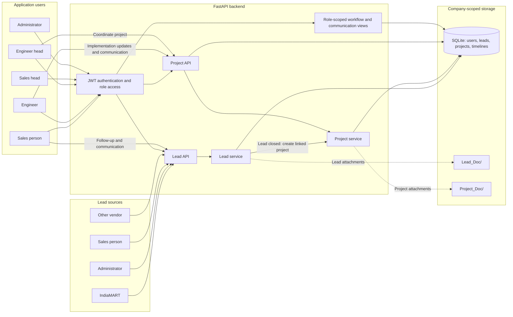

# Skybound Backend

FastAPI-based backend for the Skybound application. This service manages company onboarding, user authentication, lead tracking, project workflows, and document uploads for a multi-tenant, company-scoped SQLite setup.

## Overview

The application exposes a REST API through FastAPI and stores data in a local SQLite database named `skybound.db`. Company-level data is isolated by alias prefix, which is used to create company-specific tables such as `<>_user`, `<>_lead`, and `<>_project` as defined in `query.json`.

The server also serves uploaded files from dedicated folders:

- `Lead_Doc/`
- `Project_Doc/`
- `Company_Doc/`

## Tech Stack

- Python 3.11+
- FastAPI
- SQLite
- Pydantic + Pydantic Settings
- JWT authentication
- bcrypt password hashing
- Firebase Admin
- pandas / openpyxl for Excel bulk upload
- Uvicorn ASGI server

## Project Structure

```text
skybound-backend/
├── main.py                  # FastAPI app bootstrap
├── database.py              # SQLite helpers and query execution
├── query.json               # SQL templates for all tables and queries
├── pyproject.toml           # Python project dependencies
├── README.md                # Project documentation
├── .env                     # Local environment file (not committed)
├── Company_Doc/             # Company attachments
├── Lead_Doc/                # Lead attachments
├── Project_Doc/             # Project attachments
├── core/
│   ├── config.py            # Environment settings and database query config
│   ├── role.py              # Role enum definitions
│   └── security.py          # Security-related utilities
├── models/
│   └── response.py          # Standard response wrapper
├── routes/
│   ├── company.py           # Company registration, timelines, DB setup
│   ├── lead.py              # Lead CRUD, bulk upload, callbacks
│   ├── project.py           # Project fetch/update and project timelines
│   ├── state.py             # State/city lookup endpoints
│   ├── sales_entry.py       # Sales entry create and retrieval
│   ├── visit.py             # Sales customer visit submissions
│   └── user.py              # Auth, registration, profile, password reset
├── schemas/
│   ├── company.py
│   ├── email.py
│   ├── lead.py
│   ├── project.py
│   ├── state.py
│   ├── sales_entry.py
│   ├── visit.py
│   └── user.py
├── services/
│   ├── company.py
│   ├── lead.py
│   ├── project.py
│   ├── state.py
│   ├── sales_entry.py
│   ├── visit.py
│   └── user.py
├── utility/
│   ├── auth.py              # JWT role validation
│   ├── dateutility.py
│   ├── mail.py              # Email sending utility
│   ├── pushnotify.py        # Push notification utility
│   ├── statemgmt.py        # Company alias/state management
│   └── skybound-b63c2-firebase-adminsdk-fbsvc-e14f5bb985.json
└── skybound.db              # SQLite database created at runtime
```

## Key Features

- Multi-tenant company registration and database initialization
- User registration and login with JWT tokens
- Role-based access control for Admin, Sales, SalesHead, Engineer, EngineerHead, HR, and Customer roles
- Lead management with filters, updates, dashboard counts, and timeline comments
- Daily sales-call reporting based on lead timeline comments
- Sales visit form submissions with company-scoped persistence
- Sales entry tracking for quotation and purchase-order amounts
- Project tracking and assignment
- Bulk lead upload from Excel files
- State and city lookup endpoints
- Attachment support for lead, project, and company updates
- IndiaMART callback handling for lead creation

## Application Workflow

The application manages work from initial lead intake through project delivery:

1. **Lead creation:** A lead is the starting point for the workflow. Leads may come from IndiaMART, an administrator, a sales person, or another vendor.
2. **Sales follow-up:** A sales person follows up with the company's contact person and records communications and updates in the lead timeline.
3. **Lead completion:** Sales works toward finalizing the lead. When the lead reaches its completed/closed status, the system automatically creates a project linked to that lead.
4. **Project implementation:** An engineer head coordinates the project, and engineers carry out the implementation. Project communications and updates are recorded in the project timeline.
5. **Project closure:** Once implementation is complete, the engineer closes the project.

Administrators can view the complete workflow and its communications. Sales heads and engineer heads can view the workflow for their respective associates (sales people and engineers).

### Sales Calls API

`GET /lead/calls` returns an object with `total_calls` and a `calls` array grouped by calendar date. Each date group has a `date` and a nested `calls` array containing that day's lead and sales-person entries. Each entry represents one lead, sales person, and date on which that sales person added a non-empty lead timeline comment. Multiple comments by the same sales person on the same lead on the same date count as one call. Comments created by administrators or other non-sales users do not count. Sales users receive only their own calls, determined from their authentication token; sales heads and administrators receive calls across all sales people.

Calls may be filtered by month or week:

- Monthly: `GET /lead/calls?period=monthly&month=10&year=2026`
- ISO week 43 within October 2026: `GET /lead/calls?period=weekly&month=10&year=2026&week=43`

Weekly filters use ISO week numbers, running Monday through Sunday and numbered within the year. Results are limited to the requested month, so only the portion of the selected ISO week that falls within that month is returned. For example, ISO week 43 of 2026 overlaps October 19–25. For weekly data, send `month`, `year`, and `week` together. For monthly data, send `month` and `year`. Omitting all period filters returns calls across all dates.

Each nested call contains a `lead` object with only `id`, `name`, `status`, and `vendor`, and a `sales_person` object with only `id` and `name`. `total_calls` is the number of date groups returned.

## Dataflow and Architecture

The backend routes requests from lead sources and application users through FastAPI routers and service functions. Authentication and role-based access control determine which records each user can access, while the active company alias scopes database operations to that company's data.

Lead creation and follow-up update the company's lead records and lead timeline. When a lead is changed to `closed`, the lead service creates a linked project. Engineers then update the project and its timeline until the project is closed. Attachments are stored in the corresponding document folders; lead and project records and timelines are stored in the company-scoped SQLite tables.



## Environment Configuration

The app expects a `.env` file in the project root. The settings class in `core/config.py` reads the following values:

```env
SECRET_KEY=your_super_secret_key
ALGORITHM=HS256
ACCESS_TOKEN_EXPIRE_MINUTES=30
```

> The code uses `pydantic-settings` and expects these values to be present when the app starts.

## Setup

1. Create and activate a virtual environment:

```bash
python -m venv .venv
source .venv/bin/activate   # Linux/macOS
.venv\Scripts\activate      # Windows
```

2. Install dependencies:

```bash
pip install -e .
```

3. Create a `.env` file with the required settings.

4. Start the application:

```bash
uvicorn main:app --reload
```

Or run directly:

```bash
python main.py
```

The app binds to `0.0.0.0:8000` when launched from `main.py`.

## Runtime Behavior

The `FastAPI` app is created in `main.py` and includes routers for:

- `/user`
- `/lead`
- `/project`
- `/company`
- `/state`
- `/visit`
- `/sales-entry`

It also mounts static document directories and registers global exception handling, request validation handling, and CORS middleware.

## Core API Modules

### User APIs

Base prefix: `/user`

- `POST /user/register`
- `POST /user/login`
- `POST /user/registerAdmin`
- `GET /user/roles`
- `POST /user/resetpassword`
- `POST /user/changepassword`
- `GET /user/` or `POST /user/` for users listing/search
- `PATCH /user/` for updating a user

### Company APIs

Base prefix: `/company`

- `POST /company/register`
- `GET /company/setupdb`
- `GET /company/gettimeline`
- `POST /company/timeline`
- `POST /company/timelineEdit`
- `GET /company/timelineDelete`

### Lead APIs

Base prefix: `/lead`

- `POST /lead/create`
- `POST /lead/`
- `POST /lead/edit`
- `GET /lead/count`
- `GET /lead/calls`
- `POST /lead/timeline`
- `POST /lead/timelineEdit`
- `GET /lead/timelineDelete`
- `POST /lead/bulkupload`
- `GET /lead/delete`
- `POST /lead/indiamart/callback`

### Project APIs

Base prefix: `/project`

- `POST /project/`
- `GET /project/count`
- `POST /project/edit`
- `POST /project/timeline`
- `POST /project/timelineEdit`
- `GET /project/timelineDelete`

### State APIs

Base prefix: `/state`

- `GET /state/`
- `GET /state/{statename}`

### Visit API

Base prefix: `/visit`

- `GET /visit/` — fetch visits (Sales users see their own visits; SalesHead and Admin see all visits)
- `POST /visit/` — save a standalone customer visit (Sales role only)

Send JSON with the fields shown in [visits.jpeg](./visits.jpeg). `visit_date`, `visit_location`, `contacted_person`, `outcome`, and `remark` are required; `designation` is optional. The accepted `outcome` values are `Positive`, `Follow-up`, and `Not Interested`. The salesperson is taken from the authenticated token, and the visit is saved in the active company's visit table. For existing companies, this table is created automatically on the first visit submission.

```json
{
  "visit_date": "2026-10-19",
  "visit_location": "Customer office, Pune",
  "contacted_person": "Asha Patil",
  "designation": "Purchase Manager",
  "outcome": "Follow-up",
  "remark": "Discussed the requirement; send the revised proposal."
}
```

The response returns the generated `visit_id`.

### Sales Entry API

Base prefix: `/sales-entry`

- `POST /sales-entry/` — save a sales entry (Sales role only)
- `GET /sales-entry/` — fetch entries (Sales users see their own; SalesHead and Admin see all)

The entry follows [salesEntry.jpeg](./salesEntry.jpeg) and accepts JSON amounts for quotation sent, PO received, PO expected tomorrow, and PO expected this week. Amounts default to `0` and must be non-negative, with up to two decimal places. The entry date and salesperson are recorded by the backend from the current India time and authenticated token. Entries are stored per company; the table is initialized automatically for existing companies when the API is used.

```json
{
  "quotation_sent_amount": 0,
  "po_received_amount": 75000,
  "po_expected_tomorrow_amount": 0,
  "po_expected_this_week_amount": 765000
}
```

## Database Model Notes

The backend uses SQLite with database helpers in `database.py`:

- `get_db()` opens a new SQLite connection
- `execute_query()` handles single-row queries
- `execute_company_query()` targets company-scoped tables using the active company alias
- `fetch_single_record()` returns a single result row
- `create_table()` executes SQL scripts for schema creation

The app’s SQL definitions live in `query.json`, which is the central source for table creation and common database operations.

## Multi-Tenant Behavior

When a company is registered through `/company/register`, the backend:

1. Inserts the company into the `company` table.
2. Sets the active company alias in shared state.
3. Creates company-specific tables using the alias name.
4. Enables all subsequent data access for that company through `state.value` and `<>` replacements in SQL statements.

This allows company data to be logically separated while sharing one SQLite database.

## Notes

- The project is a backend-only service and does not include a frontend application.
- Static uploads are saved to the repository root directories and are served via FastAPI static mounts.
- The app intentionally exposes a permissive CORS configuration (`allow_origins=["*"]`) for development and integration testing.
- The project uses custom JSON response wrappers from `models/response.py` for consistent API output.

## License

This project does not currently declare a license in the repository metadata.
